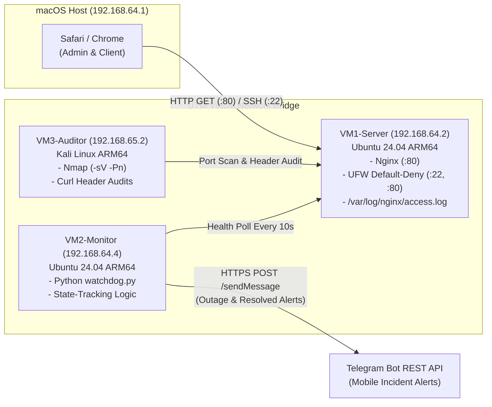
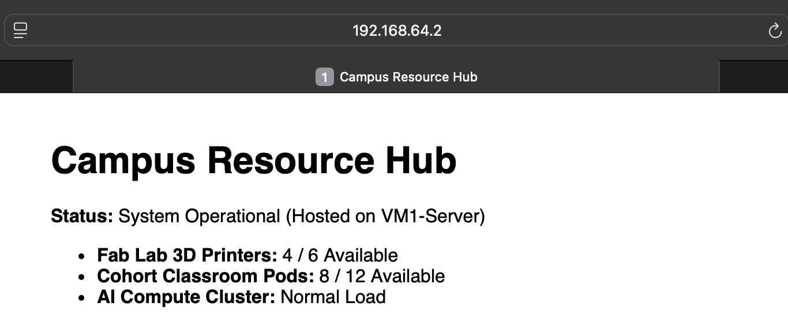
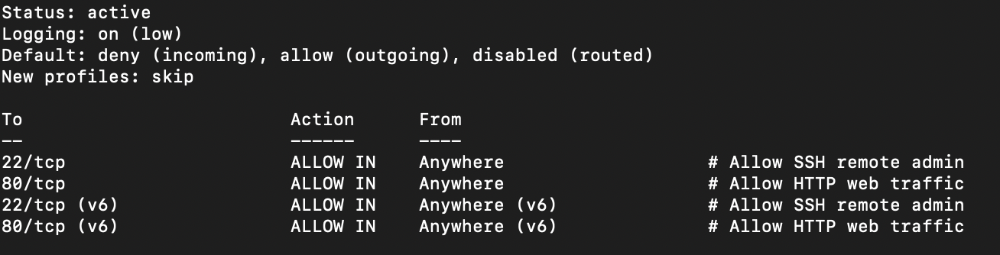
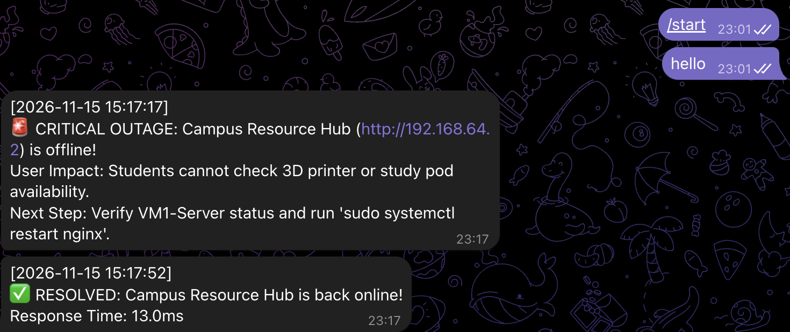
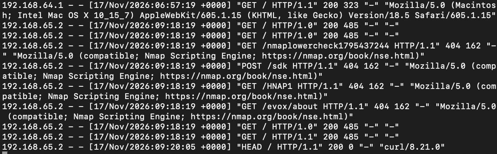

#  Smart Campus Resource Hub & Three-Node Security Lab

A self-hosted, multi-node virtualized Linux infrastructure hosting a live campus facility availability portal (`Campus Resource Hub`) paired with an independent Python health-monitoring daemon, real-time Telegram incident alerts, and a Purple Team auditing node.

---

##  System Architecture & Topology

| Node | OS | IP Address | Role |
| :--- | :--- | :--- | :--- |
| **Host Machine** | macOS (Apple Silicon) | `192.168.64.1` | UTM Hypervisor host, browser client, SSH admin |
| **`VM1-Server`** | Ubuntu Server 24.04 ARM64 | `192.168.64.2` | Nginx web host (`:80`), UFW default-deny firewall, OpenSSH (`:22`) |
| **`VM2-Monitor`** | Ubuntu Server 24.04 ARM64 | `192.168.64.4` | Independent Python watchdog daemon & Telegram Bot REST API alerting |
| **`VM3-Auditor`** | Kali Linux ARM64 | `192.168.65.2` | External attack-surface enumeration (`nmap`) & HTTP header auditing (`curl`) |

---

##  Key Features

* **Two-Node Fault Isolation:** Decouples monitoring (`VM2-Monitor`) from the web host (`VM1-Server`) so alerts fire even when the primary server goes down.
* **Least-Privilege Security (UFW):** Blocks all unsolicited inbound connections by default, permitting only `22/tcp` (SSH) and `80/tcp` (HTTP).
* **Human-Centered Alert Design:** Translates raw connection errors into plain-English Telegram alerts specifying **Student Impact** and **Recovery Commands**, using boolean state-tracking (`server_is_up`) to prevent alert spam.
* **Purple Team Log Forensics:** Validated firewall filtering via `nmap -sV -Pn` from `VM3-Auditor` and verified real-time traffic attribution in `/var/log/nginx/access.log`.

---

## 🏗️ Visual Architecture Diagram

---

##  Visual Proof & Lab Validation

### 1. Live Web Portal & Firewall Hardening

### 2. Real-Time Telegram Outage & Recovery Alerts

### 3. Forensic Nginx Access Log (`VM3-Auditor` Probes)

---

##  Engineering Challenges & Solutions

* **x86 vs. ARM64 Architecture:** Resolved VirtualBox Guru Meditation and EFI boot failures on Apple Silicon by migrating to native ARM64 images in UTM.
* **VM Cloning Isolation:** Prevented IP collisions and hostname conflicts after cloning by regenerating virtual MAC addresses and updating `/etc/hostname` and `/etc/hosts`.
* **Security & Credential Hygiene:** Removed hardcoded API tokens in favor of environment variables (`os.getenv`) and rotated exposed bot credentials.
